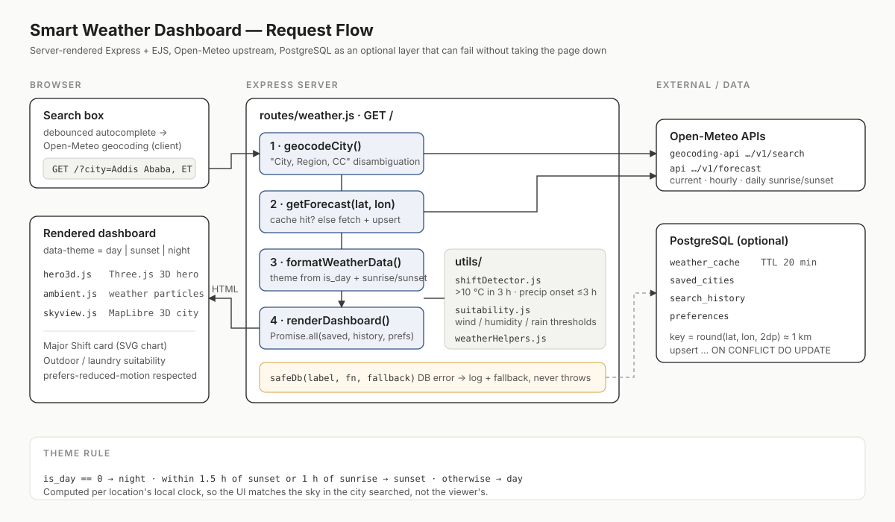
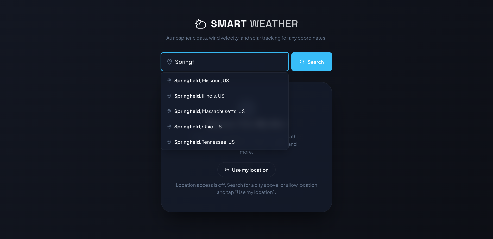
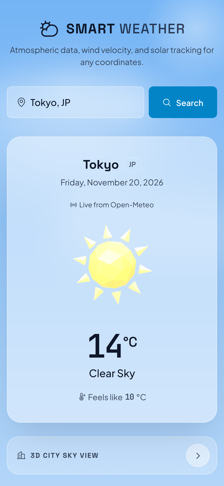

*The same app, three skies: Tokyo at midday, Addis Ababa just after sunrise, and New York at night — all captured at the same moment.*

## Overview

Most weather apps theme themselves on the **viewer's** clock. Smart Weather themes itself on the **searched city's** clock: if it's 10 p.m. in New York but sunrise in Addis Ababa, searching Addis Ababa gives you a sunrise palette. Around that core idea sits a server-rendered dashboard with city autocomplete, an 8-hour forecast, an outdoor/laundry suitability check, and a "Major Shift" warning when the weather is about to change fast.

## Architecture



Every search is a single `GET /?city=…` handled by one Express route in four steps:

1. **Geocode.** `geocodeCity()` accepts free text like `Springfield, Illinois, US`. Only the name goes to the geocoder; a trailing two-letter part becomes an ISO country filter and the remaining parts pick the right region.
2. **Forecast, with a cache.** `getForecast()` checks a PostgreSQL `weather_cache` table keyed by coordinates rounded to two decimals (≈ 1 km). On a miss it calls Open-Meteo and upserts the result with a 20-minute TTL.
3. **Format.** `formatWeatherData()` turns raw API arrays into view data and decides the theme.
4. **Render.** `renderDashboard()` loads saved cities, history and preferences in parallel and renders EJS.



*Autocomplete resolves ambiguous names to region and country, and the server re-uses those hints when the form is submitted.*

## Code highlights

### The database is optional — on purpose

PostgreSQL powers saved cities, history and the cache, but it should never be the reason a user can't see the weather. Every query goes through one wrapper that logs and falls back instead of throwing:

```js
/** Runs a DB operation; logs and returns `fallback` on failure instead of throwing. */
async function safeDb(label, fn, fallback) {
  try {
    return await fn();
  } catch (err) {
    console.error(`[DB WARN] ${label}:`, err.message);
    return fallback;
  }
}
```

A `null` result tells the template to hide that section, so the app degrades to "live weather only" rather than to an error page. (The screenshots on this page were taken exactly that way — with no database running.)

### A theme computed from the location's own clock

```js
let theme = 'day';
if (!is_day) {
  theme = 'night';
} else {
  const msToSunset = sunsetMs - currentMs;
  const msSinceSunrise = currentMs - sunriseMs;

  // Within 1.5 hours of sunset or 1 hour of sunrise
  if ((msToSunset > -1800000 && msToSunset < 5400000) ||
      (msSinceSunrise > 0 && msSinceSunrise < 3600000)) {
    theme = 'sunset';
  }
}
```

Open-Meteo is called with `timezone: 'auto'`, so `current.time`, `sunrise` and `sunset` are all in the city's local time and can be compared directly.

### Coordinate-keyed cache with an upsert

```sql
INSERT INTO weather_cache (lat_key, lon_key, payload, fetched_at)
VALUES ($1, $2, $3, now())
ON CONFLICT (lat_key, lon_key)
DO UPDATE SET payload = EXCLUDED.payload, fetched_at = EXCLUDED.fetched_at
```

Rounding to two decimals means two people searching the same city from slightly different autocomplete entries share one cache row.

## Beyond the basics

- **Major Shift Visualizer** — `shiftDetector.js` scans the next 12 hourly points for a temperature swing of more than 10 °C within 3 hours, or rain/snow/thunder starting within 3 hours while it's dry now, and emits SVG geometry for a small warning chart.
- **3D layer** — low-poly sun, cloud, raincloud and moon models made in Blender and rendered with Three.js; ambient particles matched to the forecast; a MapLibre "City Sky View" that flies to the city at a 60° pitch with extruded buildings. All motion respects `prefers-reduced-motion`.
- **Small safety details** — form redirects go through `safeReturnTo()` to block open redirects, and geolocation coordinates are rounded to ~11 m before they leave the browser.



*Mobile layout. The 3D map starts collapsed on phones to save data.*

## Next steps

- **Tests for the pure logic.** `shiftDetector`, `suitability` and the theme rule are pure functions — ideal for a small unit-test suite with recorded Open-Meteo fixtures.
- **Per-user data.** Saved cities and preferences are currently global to the deployment; adding lightweight accounts or a signed cookie would make them personal.
- **Cache warm-up for popular cities.** Pre-fetching the most searched cities would hide the free-tier cold start on the live demo.
