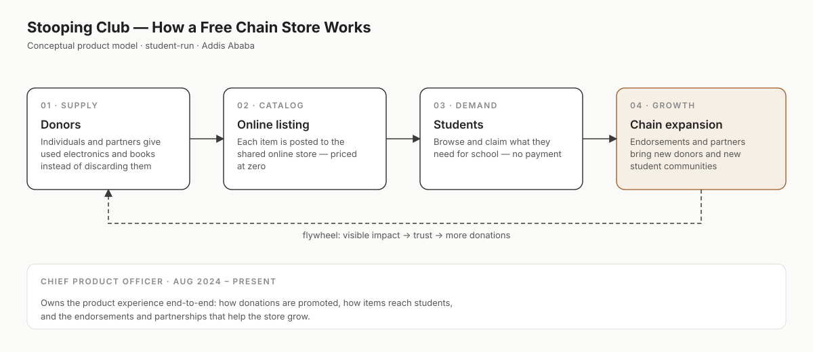

## Overview

Stooping Club is a student-run **free online chain store** based in Addis Ababa. Instead of selling goods, it collects donated electronics and books and makes them available to students at no cost — a store where every price is zero.

As Chief Product Officer, I'm responsible for the product experience: how donations are promoted, how items reach the students who need them, and the endorsements and partnerships that help the store grow.

## How it works

*A conceptual view of the model. Each stage feeds the next, and visible impact brings in new donors.*

## Impact

- **$8,000+** in donated electronics and books promoted to students.
- **5+ strategic endorsements** secured to grow the club's reach and credibility with donors.

## What I focus on as CPO

- **Promotion.** Making donated items visible to the students who can use them.
- **Trust.** Endorsements give donors confidence that what they give will be used well.
- **Growth.** Using partnerships to bring in new donors and new student communities.

## Next steps

- **Measure reach.** Track items claimed and students served alongside donation value.
- **More partners.** Turn endorsements into recurring donation partnerships.
- **Share the playbook.** Document the model so student groups elsewhere can start their own chapter.
