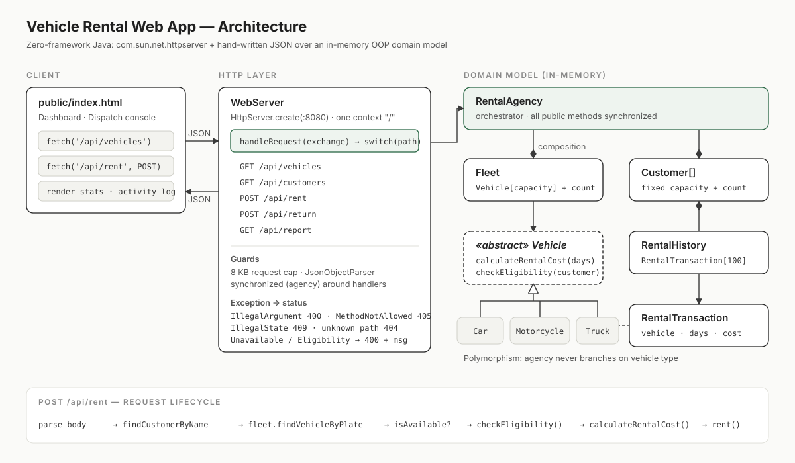
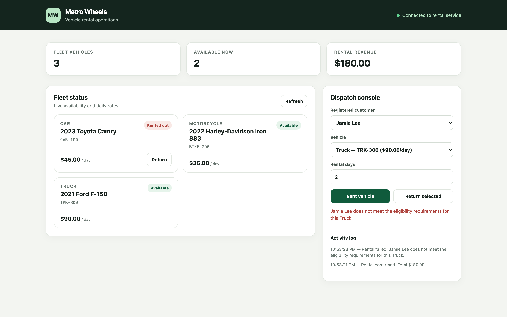

*The dispatch console after a four-day Camry rental: availability, revenue and the activity log update from the JSON API.*

## Overview

Metro Wheels is a small rental agency with cars, motorcycles and trucks. Staff pick a registered customer, a vehicle and a number of days; the server checks availability and eligibility, prices the rental, and records it. The goal was to build the whole stack **without a framework** — so routing, JSON, validation and concurrency are all explicit, readable Java.

## Architecture



- **HTTP layer.** One `HttpServer` context dispatches on path to five JSON endpoints: `GET /api/vehicles`, `GET /api/customers`, `POST /api/rent`, `POST /api/return`, `GET /api/report`. Request bodies are capped at 8 KB and parsed by a small hand-written JSON parser.
- **Errors as status codes.** Exceptions map cleanly to HTTP: `IllegalArgumentException` → 400, wrong method → 405 with an `Allow` header, `IllegalStateException` (e.g. a full fleet) → 409, unknown path → 404.
- **Domain model.** `RentalAgency` composes a `Fleet` and a fixed array of `Customer`s. Each customer owns a `RentalHistory` of `RentalTransaction`s.

## Code highlights

### Polymorphism instead of `if (vehicle instanceof Truck)`

`Vehicle` is abstract; each subclass owns its pricing and eligibility rules. Cars need a renter aged 18+, motorcycles 21+ (plus a helmet certification on some bikes), and trucks ignore age entirely and require a commercial license. The agency never branches on type:

```java
if (!vehicle.isAvailable()) {
    throw new VehicleUnavailableException(
            vehicle.getVehicleType() + " (" + licensePlate + ") is currently rented out.");
}

// POLYMORPHISM: this calls Car's, Motorcycle's, or Truck's
// own checkEligibility() implementation
if (!vehicle.checkEligibility(customer)) {
    throw new EligibilityException(
            customer.getName() + " does not meet the eligibility requirements for this "
                    + vehicle.getVehicleType() + ".");
}

double cost = vehicle.calculateRentalCost(days);
RentalTransaction transaction = new RentalTransaction(vehicle, customer, days, cost);
customer.addRentalRecord(transaction);
vehicle.rent();
```

Failures are **checked exceptions**, not `null` or `false`, so the HTTP handler is forced to turn each one into a clear message for the user:



*Jamie Lee holds a standard license, so the Truck's `checkEligibility()` rejects the rental and the API returns the reason.*

### Fixed-capacity storage with defensive copies

```java
public class Fleet {
    private final Vehicle[] vehicles;
    private int count;

    public void addVehicle(Vehicle vehicle) {
        Objects.requireNonNull(vehicle, "Vehicle cannot be null.");
        if (count == vehicles.length) {
            throw new IllegalStateException("Fleet has reached its vehicle capacity.");
        }
        vehicles[count++] = vehicle;
    }

    public Vehicle[] getAllVehicles() {
        return Arrays.copyOf(vehicles, count);
    }
}
```

Arrays with an explicit `count` keep memory bounded and make capacity a real business rule (it surfaces as a 409). Getters return copies so no caller can mutate the fleet behind the agency's back.

### Thread safety on a multi-threaded server

`HttpServer` can serve requests concurrently, so every public `RentalAgency` method is `synchronized`, and the rent/return handlers lock on the agency around the whole lookup-then-mutate sequence. Two clerks can't rent the same car at the same time.

## Next steps

- **Persistence.** `RentalHistory` was deliberately written so it's the only class that knows how transactions are stored — the natural seam for swapping arrays for a database.
- **Tests.** JUnit coverage for each vehicle's pricing and eligibility rules, plus an integration test that drives the five endpoints.
- **Late returns and mileage.** `addMileage()` already exists on `Vehicle`; wiring it to the return flow would enable mileage- or lateness-based pricing.
